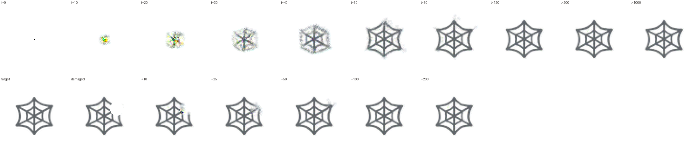
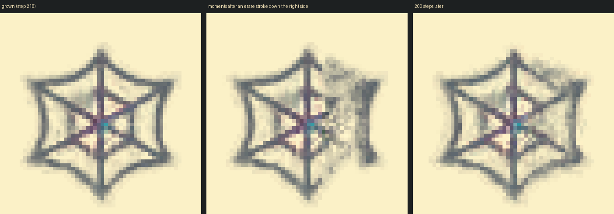

# NCA Morphogenesis

A neural cellular automaton that grows a spider web from a single cell, holds its shape,
and rebuilds it after damage, even when its centre is destroyed. A live browser sandbox
lets you wound it, inject noise and build walls while it runs.

Based on [Growing Neural Cellular Automata](https://distill.pub/2020/growing-ca/)
(Mordvintsev et al., Distill 2020). The target is the 🕸 emoji from Google's Noto Color Emoji.



*Top: growth from a single seed cell. Bottom: a random wound regrowing.*

- **Self-repairing.** Heals erased regions, injected noise and a destroyed hub, which the
  original Distill-style model cannot regrow.
- **Interactive.** The model runs in real time and streams to a browser canvas over
  WebSockets.
- **Verified.** The PyTorch model and a NumPy reference agree to 3e-5 over 40 steps,
  and a stress test measures robustness beyond the training conditions.

## Quick start

```bash
python -m venv .venv && source .venv/bin/activate   # Windows: .venv\Scripts\activate
pip install -r requirements.txt
python server.py                                     # open http://localhost:8000
```

The sandbox runs on PyTorch (CUDA, CPU, or `--device mps` on Apple silicon) and falls back
to NumPy without it; `pip install numpy starlette "uvicorn[standard]"` is enough for that.
`--checkpoint checkpoints/spiderweb/spiderweb.npz` loads the earlier model for comparison.

## The sandbox

| key | action |
|---|---|
| `E` / `N` | erase (a wound) / add noise to living cells under the brush |
| `W` / `U` | paint / remove walls; walled cells stay empty, so growth routes around them |
| `S` | plant a second seed |
| `D` | erase a random disc |
| `Space` / `.` / `R` | pause / single step / reset to one seed |
| `[` `]` | brush size |
| `1` `2` `3` | view RGBA / hidden channels 4-6 / alive mask |

Each browser tab gets its own simulation, streamed at up to 30 frames per second with
"steps per frame" setting the speed. Server options: `--checkpoint`, `--size` (grid,
default 96), `--fps`, `--steps-per-frame`, `--backend auto|torch|numpy`, `--device`,
`--host`, `--port`. The browser sends JSON commands; the server answers with JSON stats and
binary RGBA frames. `sim/session.py` documents the protocol.



*The sandbox with the earlier `spiderweb` model: a strip erased and regrown, then noise
injected and healed.*

## How it works

Every cell holds 16 numbers: colour and opacity (RGBA) plus 12 hidden channels it uses to
signal its neighbours. Each step, a cell sees its 3×3 neighbourhood through fixed identity
and Sobel filters, and a small network shared by all cells (two 1×1 convolutions, 8,320
parameters) computes its update. Cells update at random times, and a cell dies when no
cell in its neighbourhood has opacity above 0.1.

Training grows the target from one seed pixel on a 72×72 grid. A pool of 1,024 states
carries growth forward between iterations, the worst sample is reset to a seed, and the
loss backpropagates through 64-96 steps. To learn repair, samples in each batch are
damaged before the rollout:

- **random discs erased** and **noise injected** (2 samples each). Distill erases 3 discs
  and adds no noise, and a model trained only on erasure does not heal noise;
- **a disc over the centre erased** (2 samples), which teaches the model to rebuild its hub;
- **a second disc erased mid-rollout** (2 samples), to heal twice in a row.

One rule differs from the Distill code: only cells alive at the start of a step may update,
so an empty cell cannot keep a neighbour alive. The PyTorch model, the NumPy version and
the checkpoints all follow it, and `tests/test_torch_parity.py` checks this.

| requirement | where |
|---|---|
| NCA as a lightweight 2-D conv net in PyTorch | `nca/model.py`: depthwise identity/Sobel perception, 48 → 128 → 16 1×1 convs (last zero-initialised), stochastic updates, alive mask |
| growth from one pixel with a sample pool and damage | `nca/train_persistant.py` (`nca/train.py` is the original recipe) |
| frame-by-frame simulation engine | `sim/engine.py` (grid, walls, brushes, PyTorch or NumPy) and the fixed-rate loop in `server.py` |
| real-time sandbox over WebSockets | `server.py`, `sim/session.py`, `web/` |

## Results

Two models are compared below with the same tools and seeds: `preserve-hidden_nohn`, the
default, and `spiderweb`, the earlier model trained without centre damage. Errors are mean
squared error (MSE) against the target.

| `python tools/evaluate.py` | `spiderweb` | `preserve-hidden_nohn` (default) |
|---|---|---|
| growth: after 60 / 80 / 200 steps | 0.0031 / 0.00059 / 0.00008 | 0.0019 / 0.00055 / 0.00013 |
| left running: step 500 / 1,000 | 0.00006 / 0.00005 | 0.00014 / 0.00008 |
| 8 random wounds: just after → +50 → +200 steps (median) | 0.0031 → 0.00018 → 0.00006 | 0.0031 → 0.00021 → 0.00013 |
| wounds recovered after 200 steps | 7 of 8 | 8 of 8 |
| noise 0.1 / 0.3 / 0.6, then 300 steps | 0.00006 / 0.00006 / 0.00005 | 0.00014 / 0.00014 / 0.00009 |

Both grow the web, inner rings included, in about 80 steps and heal ordinary wounds and
noise. `tools/stress_test.py` goes further: it grows 16 webs from independent seeds,
applies damage the models never trained on, waits 1,000 steps, and counts a web as
recovered when its error ends below twice its undamaged level. A web can regrow whole but
a pixel off its place; the numbers in brackets also count those.

| test | `spiderweb` | `preserve-hidden_nohn` (default) |
|---|---|---|
| growth, 16 random seeds: median / worst MSE at step 5,000 | 0.00005 / 0.00006 | 0.00008 / 0.00009 |
| ...worst overlap with the target (IoU) at step 5,000 | 0.992 | 0.984 |
| erase a disc of training size (r 4-14 px) | 41/48 | 45/48 |
| ...training-size wounds that reach the hub | 8/15 | 12/15 |
| erase the hub (centre disc, r 8 px) | 0/16 | 16/16 |
| erase a 6 px slot through the centre | 0/16 | 14/16 |
| erase a bigger disc (r 16-22 px) | 5/16 | 5/16 |
| erase all but one quarter | 0/16 | 9/16 |
| erase the left half (allowing a 2 px shift) | 16/16 (16/16) | 10/16 (10/16) |
| erase the right half (allowing a 2 px shift) | 6/16 (8/16) | 5/16 (14/16) |
| erase the top half (allowing a 2 px shift) | 16/16 (16/16) | 16/16 (16/16) |
| erase the bottom half (allowing a 2 px shift) | 10/16 (12/16) | 16/16 (16/16) |
| noise 0.6 near the centre | 16/16 | 16/16 |
| noise 1.0 near the centre | 16/16 | 16/16 |
| noise 2.0 near the centre | 9/16 | 13/16 |
| noise 0.6 over the whole web | 12/16 | 15/16 |
| noise 1.0 on the 12 hidden channels only | 1/16 | 0/16 |
| grow from 4 off-centre seeds in a 160×160 dish | IoU ≥ 0.988 | IoU ≥ 0.982 |

- **The centre now heals.** Erasing the hub or a slot through it is permanent for
  `spiderweb` and almost always healed by the default model.
- **The price is a little sharpness**: an undamaged error of 0.00008 against 0.00005.
- **Halves**: each model has a weak side. The default model rebuilds the top, bottom and
  (allowing a one-pixel shift) right halves, but only 10 of 16 left halves; `spiderweb`
  struggles with the right and bottom halves. Over all four halves, allowing the shift,
  56 of 64 recover against 52 of 64.
- **Noise**: both always heal local noise of strength 1.0, beyond the training range; the
  default model copes better with stronger and web-wide noise. Scrambling every cell's
  hidden channels is almost never recoverable for either.

## How the default model was made

Each model below was fine-tuned from the one before and tested with the same stress test:

| checkpoint | trained from | iterations | undamaged MSE | hub erased | slot through centre | training-size wounds | left half |
|---|---|---|---|---|---|---|---|
| `spiderweb` | scratch | 8,000 | 0.00005 | 0/16 | 0/16 | 41/48 | 16/16 |
| `seed-damage` | `spiderweb` | 12,000 | 0.00017 | 0/16 | 0/16 | 39/48 | 16/16 |
| `preserve-hidden` | `seed-damage` | 16,000 | 0.00017 | 16/16 | 13/16 | 43/48 | 10/16 |
| `preserve-hidden_v2` | `seed-damage` | 17,000 | 0.00029 | 16/16 | 10/16 | 43/48 | 12/16 |
| `preserve-hidden_v3` | `spiderweb` | 12,000 | 0.00053 | 9/16 | 2/16 | 34/48 | 9/16 |
| `spiderweb_v2` | `spiderweb` | 13,000 | 0.00036 | 9/16 | 8/16 | 41/48 | 16/16 |
| `preserve-hidden_nohn` | `preserve-hidden` | 19,000 | 0.00008 | 16/16 | 14/16 | 45/48 | 10/16 |

- Adding centre damage (`seed-damage`, then `preserve-hidden`) taught the model to rebuild
  its hub, but made the web about three times blurrier.
- Two controlled fine-tunes of `preserve-hidden` found the cause. A larger batch changed
  nothing; turning off a hidden-state consistency loss and per-step hidden noise made the
  web twice as sharp and kept the hub regrowth. That run is the default model, and both
  options now default to off.
- A later attempt to fix the left half with half-plane wounds (`--half-damage 2`) left it
  unchanged and blurred the web three times again, so it was not kept.
- `preserve-hidden_v2`, `preserve-hidden_v3` and `spiderweb_v2` are earlier attempts kept
  for reference; `spiderweb_starter`, trained with the NumPy trainer, is the fixed model
  the tests use. Checkpoints up to `preserve-hidden_nohn` do not record their loss settings;
  newer ones do.

## Training

```bash
python -m nca.train_persistant --out checkpoints/my_web                  # GPU if available
python tools/evaluate.py --checkpoint checkpoints/my_web/my_web.npz      # growth, regrowth, noise
python tools/stress_test.py --checkpoint checkpoints/my_web/my_web.npz   # unseen damage
python server.py --checkpoint checkpoints/my_web/my_web.npz
```

A run writes `checkpoints/my_web/` with the weights (`.npz`), the full training state for
`--resume` (`.pt`), the loss log and preview images. The defaults follow the Distill
"regenerating" experiment: 8,000 iterations, batch 8, Adam at 2e-3 dropping to 2e-4.

| option | effect |
|---|---|
| `--target path.png` | any RGBA image with a transparent background |
| `--damage` / `--noise-damage` / `--seed-damage` / `--redamage N` | samples per batch with each kind of damage (all 0: growth only) |
| `--half-damage N` | samples per batch with half the grid erased (off) |
| `--init model.npz` | fine-tune from existing weights |
| `--resume run.pt` | continue a run in its own folder |
| `--grad-checkpoint` | trade ~30% speed for much less GPU memory |
| `--device cpu\|cuda\|mps` | defaults to the first available |

The default model came from this fine-tune (about 20 minutes on an RTX 3050 laptop GPU;
a rerun gives a model of the same quality, not identical weights):

```bash
python -m nca.train_persistant --init checkpoints/preserve-hidden/preserve-hidden.npz \
    --batch 16 --lr 2e-4 --iters 3000 --grad-checkpoint --out checkpoints/preserve-hidden_nohn
```

`nca/train.py` is the original trainer without centre damage, and `tools/train_numpy.py`
is a slow NumPy version with a hand-written backward pass, useful for checking the maths.

## Tests

```bash
python tests/test_torch_parity.py   # PyTorch == NumPy, forward pass and gradients
python tests/test_gradients.py      # NumPy backward pass vs finite differences
python tests/test_engine.py         # engine, brushes, protocol, WebSocket endpoint
python tests/test_training.py       # damage masks, fine-tuning, resuming, saved settings
```

## Project layout

```
nca/          model, both trainers, NumPy reference, checkpoint format, target loading
sim/          simulation engine and the per-connection protocol
server.py     Starlette app: static client + WebSocket stream loop
web/          browser canvas client
tools/        evaluate, stress test, NumPy trainer
tests/        parity, gradient, engine/server and training tests
checkpoints/  one folder per model: weights, training log, evaluations
data/         target image
docs/         sandbox screenshot
```

## Next steps

- Regrow the left half as reliably as the other three.
- Train other emoji and add a model picker to the sandbox.
- Add walls to training, so obstacle avoidance is learned rather than accidental.
- Run inference in the browser (WebGL or WebGPU) to remove the server.

## Credits and licence

- A. Mordvintsev, E. Randazzo, E. Niklasson, M. Levin. *Growing Neural Cellular Automata.*
  Distill, 2020. https://distill.pub/2020/growing-ca/
- Spider-web emoji from [Noto Color Emoji](https://github.com/googlefonts/noto-emoji) by
  Google, under the SIL Open Font License 1.1.
- Code under the [MIT License](LICENSE).
